

  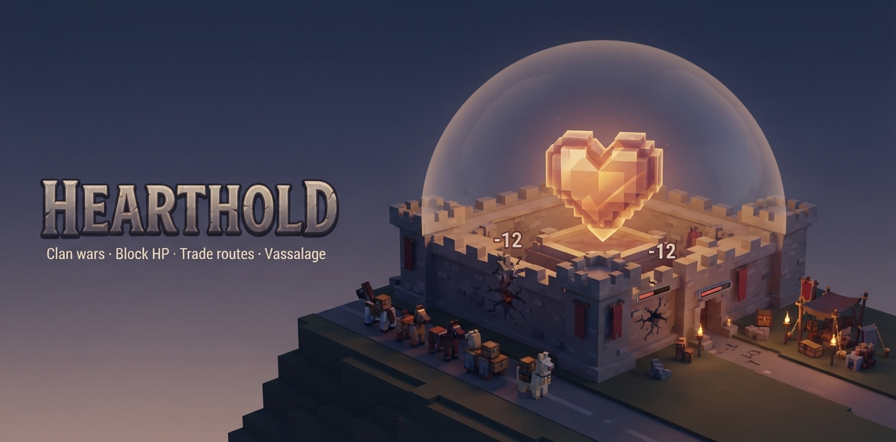

  
  
  
  
  

<h3 align="center">The clan server where a living neighbour is worth more than a dead one.</h3>

  <a href="../../releases/latest"><b>⬇ Download</b></a> ·
  <a href="docs/technical.md"><b>Install &amp; configure</b></a> ·
  <a href="docs/design.md"><b>Game rules</b></a>

---

Most clan servers end the same way: one strong group gears up in a weekend, wipes everyone in reach and is left alone on an empty map. **Hearthold** is a Paper plugin that changes the economics of that story. Bases can't be erased, sieges have a price and a schedule, resources are scattered across the map, and goods travel on foot. Clans end up needing each other, and the best loot is a trade deal or a vassal paying tribute.

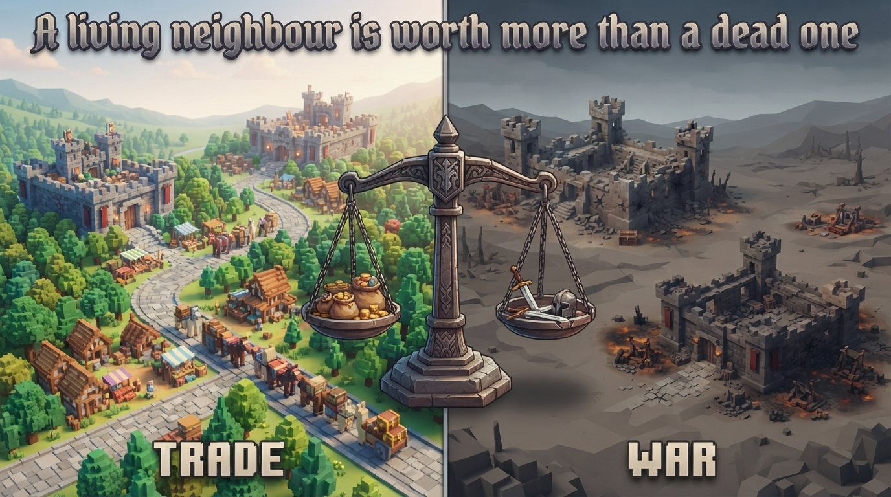

## 🏰 Your base has a heart

Place a **base heart** and a protective sphere grows around your town. Extend it with **nodes**, or plant a **proxy** outpost anywhere on the map, but outposts are fragile and can be broken in a siege. Neighbours are warned when a new heart appears, and it takes time to activate.

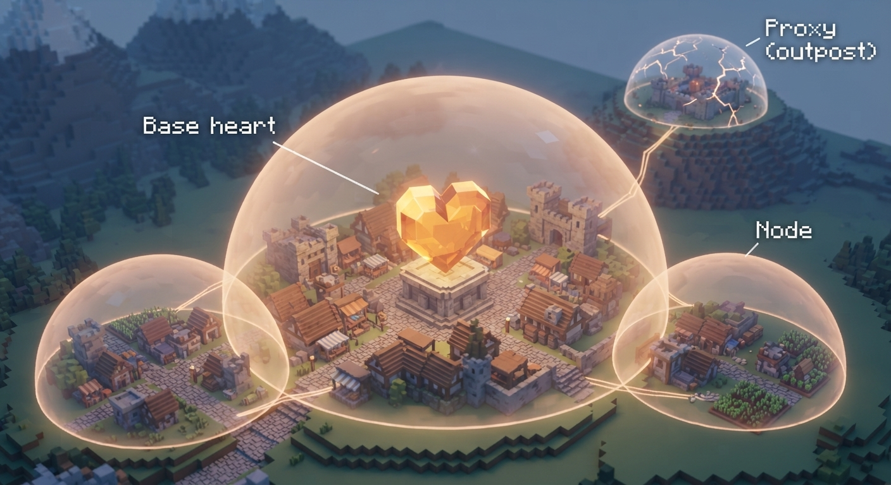

## 🧱 Walls have HP. Raids have a schedule.

There are no hard claims. Every protected block has **HP**: a hit chips it down, the block snaps back, and it slowly heals. Your tool loses as much durability as the damage it dealt, so a siege needs a backpack full of pickaxes. Outside **prime time** every hit deals 1 HP and tools wear ten times faster. Offline raids just aren't worth it.

<table>
  <tr>
    <td width="50%">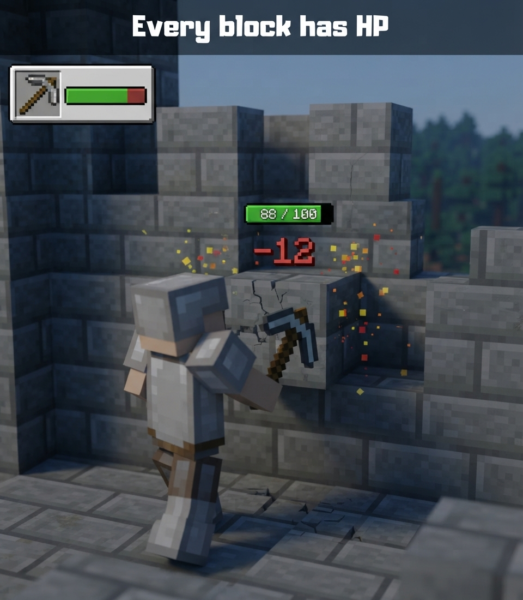</td>
    <td width="50%">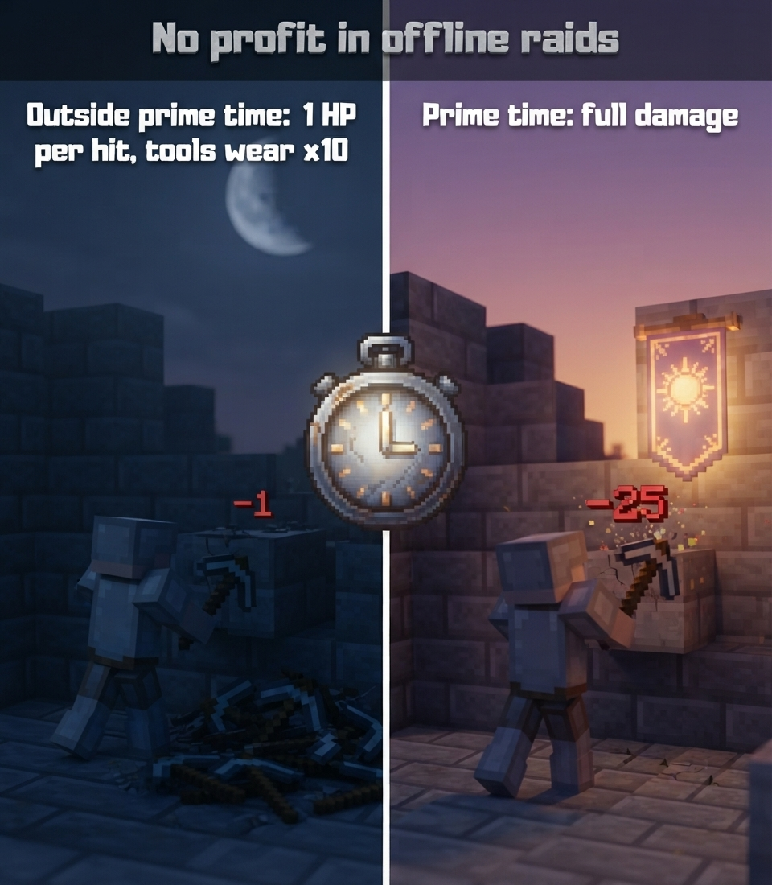</td>
  </tr>
</table>

## ⚔️ Conquer, don't erase

War is declared publicly and written into a server-wide journal. To win, break through the walls and **hold the heart** during prime time while bells ring and a pillar of fire rises above it. The loser isn't wiped. They become your **vassal for 14 days** and send you 20% of their output. Two weeks of income beats one night of loot, and the defeated clan gets a raid shield and stays in the game.

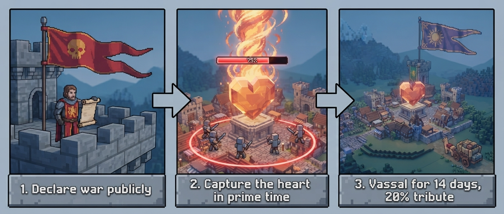

## 🐎 Trade or starve

Clans sign **trade routes** — "64 wool for 64 wood every three days" — and then someone has to actually carry the goods. Cargo has **weight**: overload yourself and you crawl, so horses, wagons and rails matter again. The cargo is packed into a sealed suitcase that your own courier can't open. Caravans can be ambushed on the road, and a broken contract goes on the public list of failed deals.

<table>
  <tr>
    <td width="50%">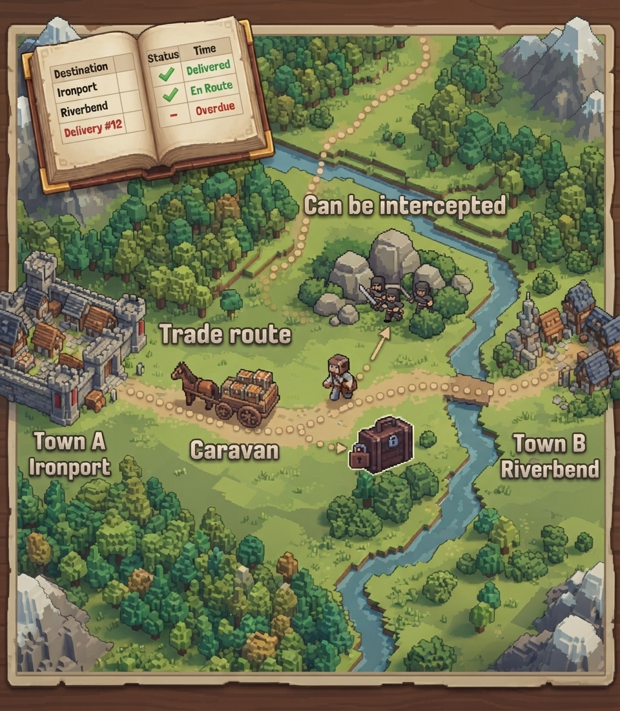</td>
    <td width="50%">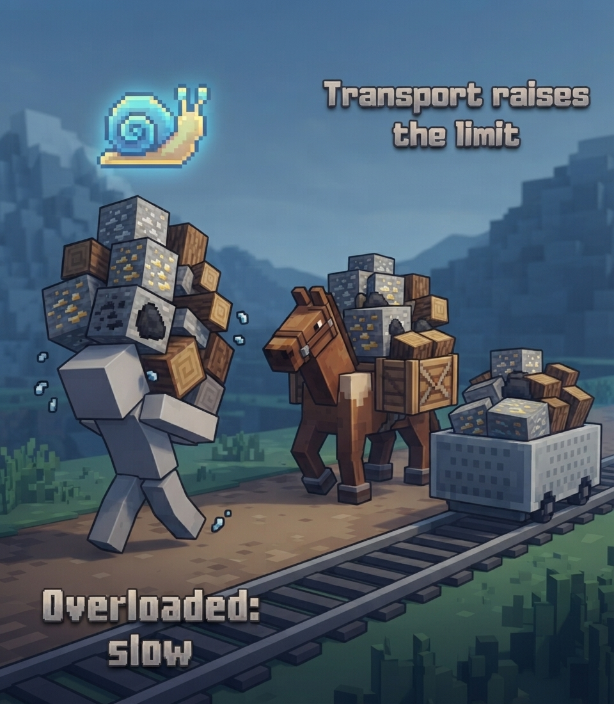</td>
  </tr>
</table>

## 🗺️ No clan produces everything

Each resource comes from only a few regions: desert, plains, mountains, forest. **Collectors** on your base gather what your region offers, shared canyons and mines respawn ore and bring rival clans face to face, and a universal buyer turns any surplus into upkeep emeralds. Everything else has to be bought, traded or taken.

<table>
  <tr>
    <td width="50%">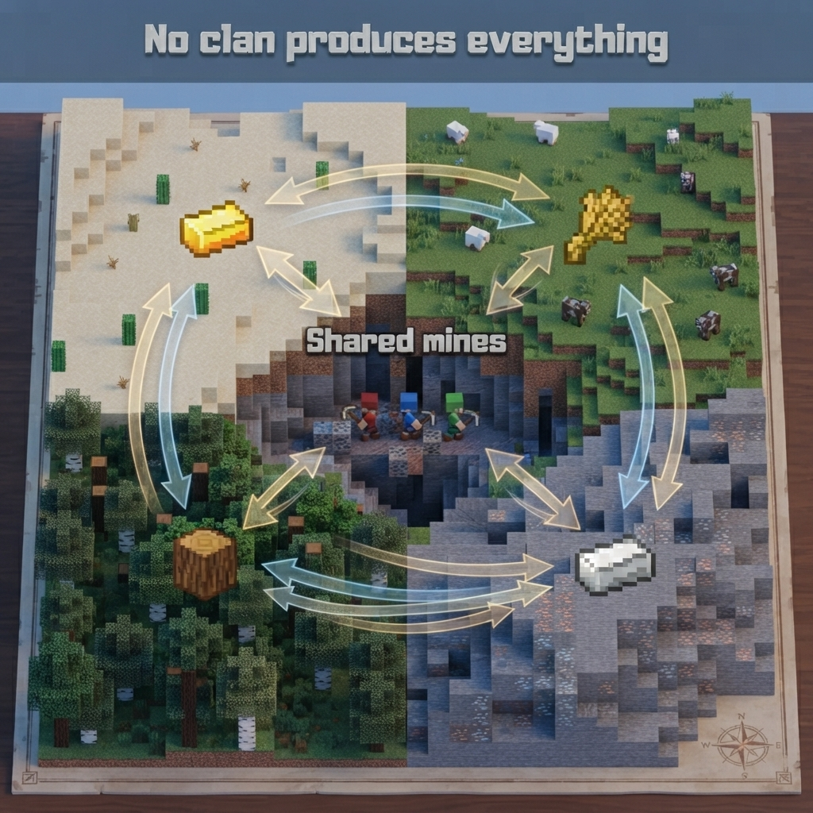</td>
    <td width="50%">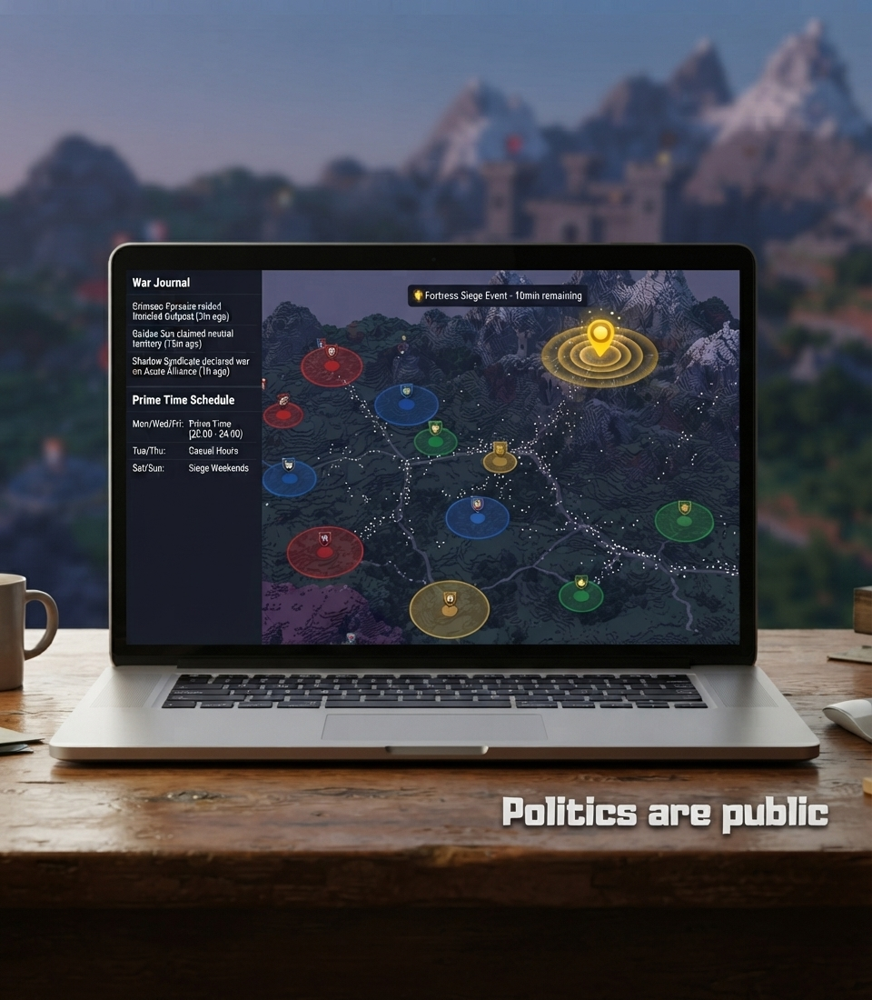</td>
  </tr>
  <tr>
    <td><b>Interdependence by design.</b> Every key resource exists in 2–3 regions at opposite ends of the map. The farther it is, the longer and riskier the route.</td>
    <td><b>Politics are public.</b> A built-in website shows bases, events, the war journal and prime time. Clans that pay for <i>scouting</i> also see players on the move.</td>
  </tr>
</table>

## 🌙 Nowhere to hide offline

When you log out you stay in the world as a sleeping **body**, and anyone's compass can find it. You're safe only at home. Plan your logouts like your raids.

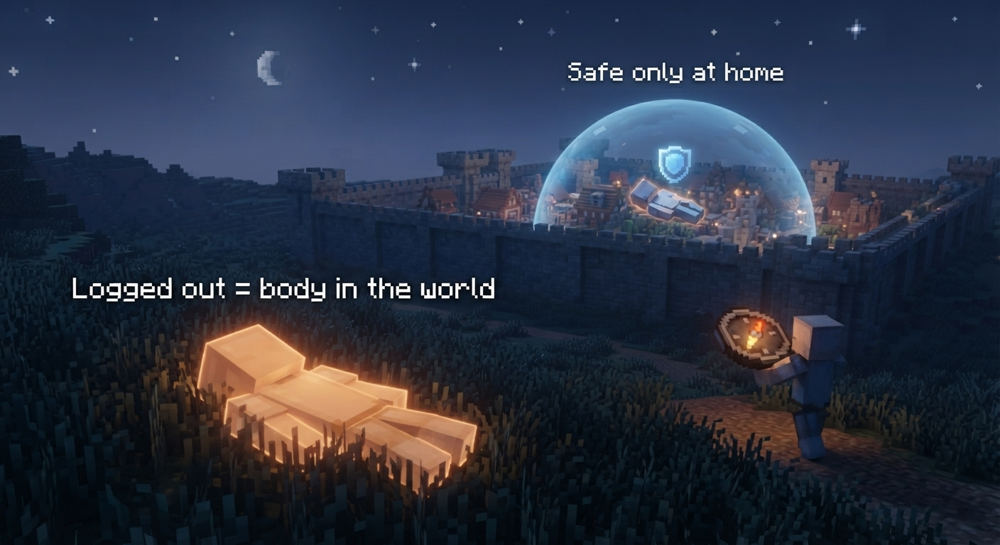

## ✨ Everything in one place

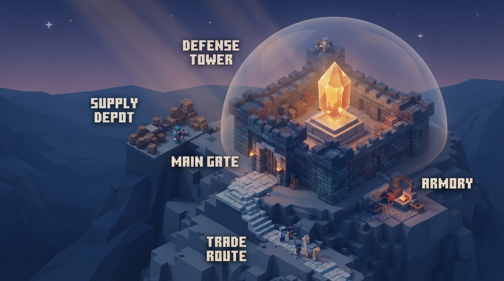

<table>
  <tr>
    <td width="50%" valign="top">

**For players**
- Every action is a button: the Hearthold compass and the base heart menu cover everything. Commands are optional.
- Roles and tags: Builder, Treasurer, Quartermaster, Trusted
- Plots inside the base, with build ratings and clan prestige
- Timed crafting: enchanting, brewing and cooking take real time
- Nether wave events and overworld loot chests
- Newbie protection for a clan's first base
- Alliances, patronage, raid shields

</td>
    <td width="50%" valign="top">

**For server owners**
- A single jar: SQLite storage and the web portal are built in
- English and Russian out of the box; any text can be overridden
- Every number in a commented `config.yml`
- An admin menu, plus a web admin panel with balance tables
- Built-in world border and pre-generation
- A HUD panel showing weight, territory, relations and chunk energy

</td>
  </tr>
</table>

## 🚀 Get started

1. Download `hearthold-<version>.jar` from **[Releases](../../releases/latest)**.
2. Drop it into the `plugins/` folder of a **Paper 26.3** server running **Java 25**.
3. Start the server, set `language`, the map border and `web.public-url` in `plugins/Hearthold/config.yml`, and run `/hearthold reload`.

Building from source, configuration, commands and permissions: **[technical documentation →](docs/technical.md)**

---

  Inspired by <b>Minto</b>, a clan server whose seasons kept ending with an empty map. Hearthold is a redesign built around one idea: make clans depend on each other. 
  <a href="docs/technical.md">Technical docs</a> · <a href="docs/design.md">Design document</a> · <a href="AGENTS.md">Contributing</a> · <a href="LICENSE">MIT license</a>

